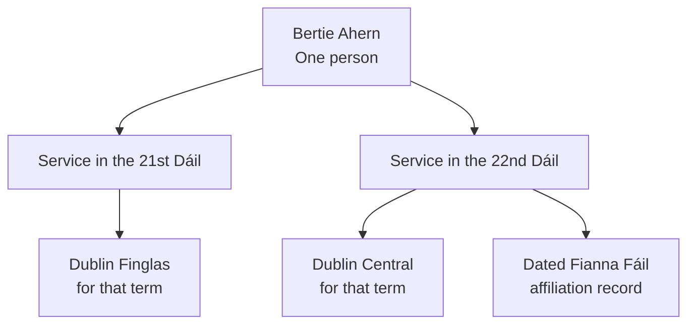
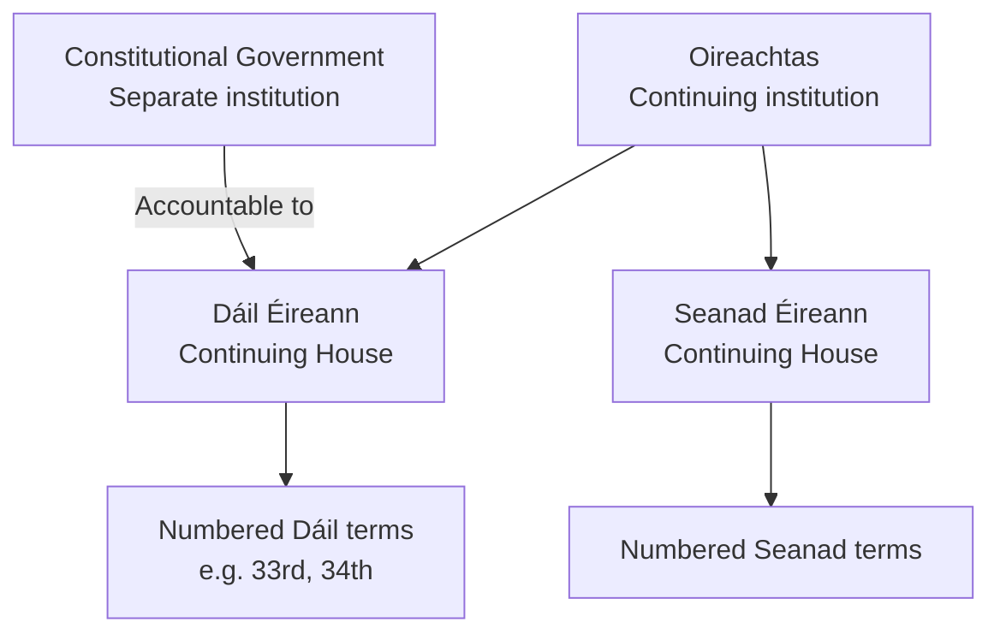

# Understanding the Oireachtas ontology

This guide explains how the Oireachtas ontology describes parliamentary
institutions, people and business, using examples familiar to readers of
Oireachtas records. You do **not** need to know RDF or OWL to follow it.

An *ontology* is a shared description of the kinds of things the data
contains and how they relate. In this project it helps distinguish, for
example, **the Dáil as an institution** from **the 34th Dáil as a particular
parliamentary term**, or **a Member** from **that Member's period of service**.
Those distinctions make historical questions more reliable.

The guide describes the **implemented model**, not proposed future
functionality. A concept being present in the ontology does not necessarily
mean that its data has been loaded. [Coverage and limitations](#what-is-available-and-what-is-not)
are explained below. For exact technical definitions, start with the
[OWL module index](../../ontology/README.md).

## A worked example: one person, several parliamentary terms

Consider Bertie Ahern. The data identifies **Bertie Ahern as one person**,
while recording his parliamentary service separately for each relevant
Dáil term.

- His representation in the **21st Dáil** was **Dublin Finglas**.
- His representation in the **22nd Dáil** was **Dublin Central**.
- A separate record connects his 22nd Dáil service with the **Fianna Fáil**
  parliamentary party collection for that term.

*Simplified illustration:* the actual model has distinct, dated records for
parliamentary service and party affiliation. The source-backed details in this
example were observed in a **local development dataset on 20 October 2026**;
they are not a certification of production coverage.

Why not just attach "Dublin Central" or "Fianna Fáil" directly to the person?
Because doing so could make a statement about one parliamentary term appear
to be true throughout an entire career. The same principle applies to
committee membership and ministerial office-holding.

## How to read the model

An ontology uses some technical language, but the ideas are straightforward:

| Term | Meaning in this guide | Oireachtas example |
| --- | --- | --- |
| **Entity** or **resource** | A particular thing recorded in the data | Bertie Ahern, the Dáil, or a Bill |
| **Class** | A category of things | Member, House, or Committee |
| **Relationship** | A connection between things | A membership record refers to the 22nd Dáil |
| **Membership record** | A relationship with its own context, often including dates | A person's service in a House or affiliation with a party |
| **Identifier (IRI)** | A unique address used to identify a particular resource | The identifier for the 22nd Dáil, not merely its displayed name |
| **Label** | The name shown to readers | "Fianna Fáil" or "Dublin Central" |

RDF stores information as statements of the form **thing → relationship →
other thing (or value)**. For example, the person is linked to a *service
record*, which in turn is linked to a particular Dáil term. RDF calls the
three parts *subject*, *predicate* and *object*.

OWL defines the categories and relationships that can be used and some of
their formal meanings. You can understand the examples in this guide without
reading the OWL definitions.

Two further distinctions matter when exploring the data:

- **Names are not identities.** A label such as "Fianna Fáil" may appear on
  several distinct, term-specific parliamentary collections. A person's
  name alone is not sufficient evidence that two records identify the same
  person.
- **Information is held in separate graphs.** A Member record can point
  to a constituency, party, committee or House described elsewhere. These
  collections of statements are called *named graphs*. Following the
  identifier across graphs reveals the other resource's details.

For hands-on examples, see the [SPARQL cookbook](sparql-cookbook.md) or
[direct graph exploration guide](graph-exploration.md).

## The Oireachtas, its Houses and their terms

### A continuing institution versus a numbered term

The **Dáil** continues as an institution even though one numbered Dáil
ends and another begins. The **33rd Dáil** and **34th Dáil** are therefore
different parliamentary terms of the same House. The Seanad is represented
in the same way.

The model also records each term's number, seat count and time period.
A term's beginning and end are not necessarily the dates on which an
individual Member began and ended service.

The arrows between the Oireachtas and the Houses mean **institutional
organisation**. They do not mean that a House is a different *kind* of
Oireachtas.

The **constitutional Government** is modelled separately from the
Oireachtas and its Houses. Its relationship of responsibility is to the
continuing Dáil, not to only one numbered term. The generic "Government"
submitter used in Bill source data is a *source category*, not the
Government institution itself.

**Scope boundary:** although the President is part of the constitutional
composition of the Oireachtas, this ETL does not model or populate a
President resource. Do not infer one from the diagram.

*Technical names:* the continuing Oireachtas is an individual
`agents:ParliamentaryBody`; the Dáil and Seanad are individual
`agents:House` resources; numbered terms are `agents:HouseTerm` resources.
The model uses `agents:termOf` / `agents:hasTerm` for House-to-term
relationships and ORG's sub-organisation relationship between the
Oireachtas and Houses. Government is a separate `agents:Government`
individual, related to the Dáil by `agents:responsibleTo`. These are
individual institutions and terms, not classes minted for each named body.
See [institutions and legislation](../reference/ontology/institutions-and-legislation.md).

## Members, representation and political affiliation

### One Member, several periods of service

A **Member** is a person. A separate **Oireachtas membership** record
describes service in a particular numbered Dáil or Seanad, with its own
dates. A person may have successive membership records or serve in
different Houses at different points in a career.

Each service record refers to the continuing House and the numbered term.
Where supplied, it also refers to a **Dáil constituency** or **Seanad
panel**. These representation resources belong to their particular
parliamentary term: a constituency with the same name in a later term is
not automatically the same modelled resource.

This allows questions such as "Which constituency did this Deputy
represent during the 22nd Dáil?" without assuming the answer also
applied during the 21st.

*Technical names:* `agents:Member` identifies the person;
`members:OireachtasMembership` is the service record, linked through
`members:inHouseTerm`, `members:isOireachtasMembershipOf`,
`members:hasMembershipDateRange` and, where available,
`members:isRepresentativeFrom`. Dáil constituencies and Seanad panels
are distinct term-scoped types. Their descriptions are retrieved from
the relevant owner graphs.

### Parties, Independents and recognised groups are different things

The ontology does not treat "member of Fianna Fáil" as one permanent fact
about a person. It uses a **dated affiliation record** associated with
that person's parliamentary service.

It is important to distinguish:

- **Parliamentary party collection:** the Members associated with a
  registered party in a *particular House term*, as represented by the
  Parties API. The Fianna Fáil collection for the 22nd Dáil is not the
  enduring political-party organisation.
- **Independent collection:** the Members represented by the API as
  Independent or non-party in that term. It does **not** assert that
  they form a political party or act as one recognised group.
- **Recognised parliamentary group:** a group recognised under the
  relevant House's Standing Orders. A **technical group** is a kind of
  recognised group. Being a parliamentary party does not automatically
  establish recognition as a group.

For a party, the dated relationship is a **PartyMembership**. For
Independent status, a more general **ParliamentaryCollectionMembership**
is used; the model does not invent membership of an "Independent Party".
The dates of an individual's affiliation are separate from the overall
House-term dates.

Where separately reviewed evidence supports it, a term-specific party
collection can also be connected to a **local enduring political
affiliation identity** or to an **external political-party identity**.
Those are different links: they do not turn the parliamentary collection
into the party organisation, and matching names are not enough to make
the connection. The local identity may describe a party, alliance or
other reviewed affiliation.

The current Parties/Members ETL does **not** create recognised
parliamentary-group instances from ordinary party or Independent
records alone.

*Technical names:* `members:ParliamentaryMemberCollection` covers
parliamentary collections; `members:ParliamentaryParty` and
`members:IndependentMemberCollection` distinguish their API categories.
`members:ParliamentaryCollectionMembership` links a Member to a
collection and to their `OireachtasMembership`. For parties, the more
specific `members:PartyMembership` and `members:isPartyMembershipOf`
apply. `members:ParliamentaryGroup` and `members:TechnicalGroup` are
separate group concepts. `members:hasPoliticalAffiliationIdentity` links
a collection to a reviewed local identity, whereas
`members:recognisedAsParty` is a reviewed external association, **not**
`owl:sameAs`. See [parliamentary member collections](../architecture/member-collections.md)
and [party identities](../architecture/party-identities.md).

## Committees and committee membership

A **committee** and a **person's membership of that committee** are
different records. Committee membership can have its own start and end
dates and a role, such as Chair or Deputy Chair. It is not the same as
membership of the Dáil or Seanad, even when a committee sits in a chamber.

The ontology includes committee types and purposes. The current
mappings do not fully cover committee operational dates, lifecycle
status, expiry or historical name periods. Missing information in those
fields should not be read as proof that a committee did not exist.

*Technical names:* `members:Committee` identifies a committee and
`members:CommitteeMembership` identifies a dated person's membership.
`members:isCommitteeMembershipOf` and `members:hasCommitteeRole` link
the committee and role. Committee descriptions and Member membership
records can be held in different named graphs.

## Government, ministerial offices and departments

An example helps separate the concepts:

- **Minister for Finance** is an *office* that continues when its holder
  changes.
- The **person holding that office** is a separate identity.
- The **period during which the person holds it** is an office-holding
  record, with its own dates.
- The **Department of Finance** is an administrative unit, not the
  office or its holder.
- **Cabinet membership** is another relationship, involving a Member's
  role in the constitutional Government. It may be supported by one or
  more office-holding periods.

The ontology also distinguishes an **office type** (a category used to
describe offices) from a particular named office. It does not infer
that every office name in source data is a confirmed, enduring office
identity. Named offices and administrative units are introduced through
reviewed evidence.

Similarly, the constitutional **Government**, the
**GovernmentExecutive** concept and **GovernmentBenches** are not
interchangeable. GovernmentBenches concerns a parliamentary whip bloc,
not an executive administration.

*Technical names:* `members:NamedOffice`, `members:AdministrativeUnit`,
`members:OfficeHolding`, `members:OfficeType` and
`members:CabinetMembership` identify these layers. Office holdings
use `members:heldOffice` and dated holder links; an OfficeType is a
controlled `SKOS` category, not a named office or OWL role. See the
[office registry](../reference/offices/registry.md) and
[office reconciliation notes](../development/reconciliation/offices.md).

## Bills and the stages of legislation

A **Bill** is not only a document title. Its parliamentary history
includes the Bill itself, versions and documents, an associated
legislative process, stages, activities, statuses and participants.

The ontology uses the established **ELI** (European Legislation
Identifier) and **ELI-DL** (its draft-legislation model), rather than
inventing a separate local model of Bills. The distinction between a
*Work*, an *Expression* and a *Format* allows a legislative work to be
distinguished from its particular versions or expressions and their
available formats.

The **legislative process** records matters such as process number,
type, status, submitting source and latest activity. Actual events
and stage occurrences belong to that process. A named stage or status
is a **controlled value**; it is not itself evidence that a particular
event happened.

A Bill can also refer to an originating House, numbered House terms
and sponsoring Members. Sponsorship, amendments and lifecycle
activities have their own records where supported by the source.

The introduction/presentation activity (`oir:BillDelivery`) produces the
Bill Work (`eli-dl:DraftLegislationWork`) through
`eli-dl:created_a_realization_of`. That same activity belongs to its
`eli-dl:LegislativeProcess` through `eli-dl:forms_part_of`. This two-edge
path connects a Bill to **its own process**, even if a query encounters
several Bills in one graph. It also covers application/by-application
delivery methods; no delivery date is inferred. There is no new direct
Bill-to-process property. The Bill is not an `eli:LegalResource`: its Work type
is `eli:work_type oir:Bill`, with `oir:Bill` an ELI WorkType. Bill Work short and
long titles use `dct:title` and `dct:alternative`; the compound identifier uses
`dct:identifier`. Values and language tags are preserved on the Work, not
invented on individual Expressions. Enacted Acts remain separate LegalResources.

Previously published graphs need regeneration before this path can be
queried; graph co-ownership alone is not relationship evidence. Bills publication
contract 2 forces regeneration of older observed Bills even with unchanged source
hashes. Complete coverage needs the separately authorized single full Bills reload,
not merely an incremental refresh.

For the exact mapped fields and source limitations, see the
[legislation ETL reference](../reference/etl/legislation.md) and
[Bill mapping](../../mappings/bill_mapping.csv).

## Debates, questions and votes

The Debates part of the model describes the **structure of parliamentary
records**, not simply a block of transcript text. It can represent:

- A debate record and its expression, with ordered sections and
  subsections.
- Speeches, summaries and parliamentary questions within that
  structure.
- A sitting, **when the source establishes that an actual sitting
  occurred**.
- Divisions (votes), including supported counts and individual
  voting records.

A **written-answer record** is still a debate record, but does not
by itself establish a sitting. The model does not assume a one-to-one
question-to-answer link.

A vote outcome is recorded only where the source supports it. An
unknown or "declared" outcome is not silently reclassified as carried
or lost, and committee roll-call attendance is not treated as a
division.

Debates may refer to Members, Houses, terms, committees, offices and
Bills where an exact supported match exists. An unresolved reference
does not create a guessed or placeholder identity. **Transcript text
itself is not stored as RDF** in this model.

See the [Debates identity contract](../architecture/debate-identities.md)
and [mapping and implementation reference](../reference/debates/mapping-and-implementation.md).

## What is available and what is not

**A defined class is not the same as populated data.** The ontology
and transformations describe what can be represented; source
coverage, successful ingestion and graph publication determine what
can actually be queried.

The following are **observations from the local development Fuseki
dataset inspected on 20 October 2026**, not up-to-date production
coverage figures:

| Area | Observed development evidence or limitation |
| --- | --- |
| Houses and terms | House labels and HouseTerms are Houses-owned. The enduring Government resource was defined in the ontology, but a global lookup found no description for it in that dataset. Office and Cabinet records did refer to Government. |
| Committees | 267 Committee identities and 3,054 CommitteeMembership records. Some committee lifecycle fields were not mapped. |
| Offices | 3 NamedOffices, 22 OfficeHoldings, 22 CabinetMemberships and 1 AdministrativeUnit. These numbers do **not** imply complete office coverage. |
| Bills | 6,044 Bill graphs. That historical snapshot predated the BillDelivery-to-Work relationship correction; its graphs were not verified to contain the new path. |
| Debates | Only 3 Debates graphs. The ontology and transformer existed, but the approved 2011+ production selection had not been ingested at that point. |

Do not interpret a missing description in that snapshot as evidence
that an institution, membership or event never existed. Consult
current publication evidence before describing live data coverage.
The historical [Debates implementation report](../reports/debates/phase-7-implementation-history.md)
explains the snapshot's readiness context.

## Practical rules for interpreting results

1. **Ask "which term?"** "Fianna Fáil" or "Dublin Central" may label
   separate term-specific resources. A familiar label does not identify
   one record across all dates.
2. **Read the dated relationship.** Service in a House, affiliation
   with a party, committee membership and office-holding each have
   their own period. The House term's dates are not a substitute.
3. **Do not assume a missing end date means "still active".** It may
   mean the source did not supply an end. When asking whether two
   periods coincide, compare their actual dates, not merely the House
   term to which they belong.
4. **Follow identifiers across graphs.** The Member graph need not
   repeat a party's or constituency's name and description. Related
   resources are joined by their identifiers, not matching labels.
5. **Treat identity links carefully.** Distinct identifiers represent
   distinct modelled things unless the applicable contract relates
   them. A reviewed external association with a party is not an
   assertion that the two resources are identical.
6. **Check coverage before inferring absence.** A relationship might
   be supported by the ontology but absent from a particular source
   capture, development dataset or published graph.

For query authors: date-range overlap, missing end dates and date
datatype handling require explicit care. The
[SPARQL cookbook](sparql-cookbook.md) gives runnable patterns.

## Where to go next

This guide deliberately puts parliamentary meaning ahead of low-level
RDF property inventories. The authoritative definitions and mappings
remain in the repository:

- [Ontology reference by topic](../reference/ontology/institutions-and-legislation.md):
  [institutions](../reference/ontology/institutions-and-legislation.md),
  [members, parties and offices](../reference/ontology/membership-parties-offices.md),
  [Bills and events](../reference/ontology/bills-and-events.md), and
  [Debates and vocabularies](../reference/ontology/debates-and-vocabularies.md).
- [OWL modules and full term definitions](../../ontology/README.md).
- [API-to-RDF mapping notes](../../documentation/mapping_notes.md),
  [mapping CSVs](../../mappings/) and
  [ETL architecture](../architecture/etl.md).
- [SPARQL cookbook](sparql-cookbook.md) for queries and
  [graph exploration](graph-exploration.md) for inspecting data.

In technical material, names beginning `agents:`, `members:`,
`debates:`, `eli-dl:` or `org:` are shortened forms of full RDF
identifiers. Their precise meanings are defined in the linked
vocabulary files; the English names used in this guide are
explanations, not substitute identifiers.
