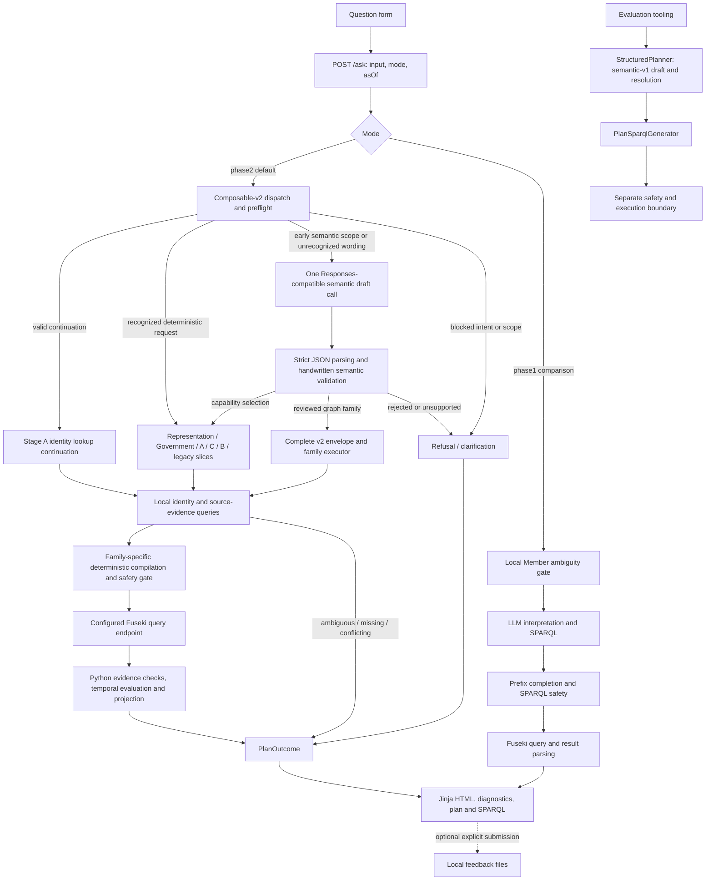

# OireachtasOntology NLQ — Stage 1: Forensic Implementation Architecture Reconstruction

> Persistence note: This report was initially delivered for human review after a
> read-only investigation. The user subsequently authorized saving it here.
> Working-tree cleanliness and no-change statements below describe that
> investigation, before this report file was added. No Stage 2 work is authorized
> or recorded by this document.

## 1. Baseline and evidence inventory

### Baseline

| Item | Finding | Classification |
|---|---|---|
| Repository | `stephenrigney/OireachtasOntology`, expected working directory | **Observed—Git execution** |
| Branch | `master` | **Observed—Git execution** |
| HEAD, local `master`, cached `origin/master` | `563a385173d312d33d22ca7868524714487967aa` | **Observed—Git execution** |
| Commit | Merge PR #30, `query-service-capability-flexibility`; timestamp `2026-11-10 14:33:43 +0000` | **Observed—Git execution** |
| Working tree | No tracked changes or non-ignored untracked files; staged and unstaged diffs empty | **Observed—Git execution** |
| Remote freshness | No fetch performed; cached `origin/master` is not proof of current GitHub state | **Unknown** |
| Diagnostic environment | `.venv` Python `3.12.14`; `pytest` and `jsonschema` unavailable | **Observed—diagnostic execution** |
| Current application, credentials and dataset | Not contacted or inspected for live availability | **Unknown** |

**Observed—investigation:** No repository files were changed. No launcher, bootstrap, dataset reload, SPARQL request, dependency installation, benchmark campaign, commit or PR was performed. The report was initially delivered in the conversation rather than written into the repository.

### Evidence terminology

- **Observed—static:** directly inspected implementation or test expectations; not proof of runtime invocation.
- **Observed—historical:** directly inspected retained evidence from an earlier execution.
- **Observed—execution:** diagnostic executed during this investigation.
- **Inferred:** reconstruction supported by evidence, but not directly traced.
- **Hypothesis:** possible explanation requiring further evidence.
- **Unknown:** not established.

### Inventory and provenance

**Observed—static:** Discovery began with `docs/README.md`, which distinguishes implementation/specification authority from historical reports (`docs/README.md:3–7,71–84`).

| Evidence | Paths | Provenance, relevance and limitations |
|---|---|---|
| Current implementation and launcher | `poc/nlq/*.py`, `poc/nlq/templates/`, `scripts/dev-nlq.sh` | Implemented request, planning, compilation and presentation boundaries. Static inspection does not establish live reachability. |
| Technical specifications | `poc/specs/query-service-plan.md`; `query-schema-contract.json`; `query-plan-contract.json`; `composable-query-plan-contract.json`; accompanying schemas/examples | Intended contracts. Versions inspected: query-schema **2.12.0**, semantic-v1 **1.2.0**, composable **2.29.0**. The roadmap explicitly mixes implemented and future behavior (`query-service-plan.md:3–9`). |
| Architecture investigations | `docs/architecture/nlq-semantic-dispatch.md`; `docs/reports/query-service/history/query-plan-redesign-{requirements,design}.md` | Proposed architecture and historical redesign, not runtime evidence. Semantic-dispatch document explicitly remains proposed (`:3–6`). |
| Human question sources | External files: `/var/home/stephen/Documents/Scratch/question-report.md`, `questions-2.md`, `questions-3.md` | Existing Question/Expected/Actual records. Repository provenance and their expansion into 26 cases: `docs/reports/query-service/user-question-regression.md:38–52,80–107`. These are distinct from authored holdouts. |
| Local feedback | `data/local/nlq-feedback/{4ef7dbb0e6524916a526dde4cfef212b,ee545505a90f44259b22b43e62285dbc,1c26fb222ba948d082a0eb4c8c00bc06}.jsonl` and `.json` sidecars | Respectively 16, 2 and 0 records; sidecars inactive. Git-ignored. Records contain question, expected, actual and adequacy only; author, timestamp, serving SHA, plan and SPARQL are not stored (`poc/nlq/feedback.py:64–81`). |
| Approved/authored questions | `poc/specs/query-service-questions-approved.md`, `query-service-unseen-questions-approved.md`, `query-service-fresh-holdout-20261101.md` | Requirements/evaluation inputs, not observed answers. “Research-style” unseen questions explicitly were not solicited from external researchers (`query-service-unseen-questions-approved.md:3–13`). |
| Benchmark definitions | `poc/nlq/benchmarks/{benchmark-v1,benchmark-v2,benchmark-v3,planner-benchmark-v1,realistic-phase2-v1,realistic-phase2-planner-v1,query-service-phase-2-v1}.json` | Existing inputs, expected results and accepted-plan fixtures. Not newly executed or rescored. Source/capture pins are in `development-{api-capture,source}-selection.json`. |
| Retained committed responses | `docs/reports/query-service/fresh-holdout-20261101-{baseline-responses,configured-baseline-responses,diagnostic-reruns}.json`; `temporal-aggregation-holdout-20261103-responses.json` | Distinct historical collections. November 1 report distinguishes an invalidated unconfigured collection from configured reruns (`fresh-holdout-20261101.md:27–65`). November 3 records a different SHA and provider failures (`temporal-aggregation-holdout-20261103.md:35–61`). |
| Independent evaluation bundle | `docs/reports/query-service/independent-generalisation/` | Frozen questions, source hashes/patch, oracle context, compressed main/regression/variability responses and assessments. Its report discloses dirty-source attribution and independence limitations (`independent-generalisation-evaluation.md:41–99`). Compressed responses were inventoried, not re-evaluated. |
| Historical capability/investigation reports | `bounded-composition-reuse.md`, `interpretation-clarification.md`, `bill-capability-inventory.md`, `bill-publication-evidence-review.md`, `planner-http-400-diagnosis-20261103.md`, `group-a-membership-periods.md`, `group-b-committee-officeholder.md`, `capability-flexibility-tranche-1.md` under `docs/reports/query-service/` | Relevant architectural lineage and dated observations. Their conclusions are not adopted as current findings. Earlier Phase 1/completion reports remain under `history/`. |
| Human-question execution artifacts | External directory `/tmp/opencode/query-service-user-coverage/integration-live-2026-11-06/` | Existing HTML and summary supporting the three paths below. Repository retention pointer: `user-question-regression.md:625–655`. These disposable artifacts are not revision-pinned evidence for current HEAD. |

**Observed—historical inventory:** Additional local investigation collections survive under `/tmp/opencode/query-service-generalisation/` and `/tmp/oireachtasontology/{group-a,group-b,six-query-investigation,temporal-generalisation,tranche-2,term-count-pilot,query-service-profiling}/`. They were identified as supplementary historical evidence, not interpreted as present capability results.

---

## 2. Actual architecture

**Observed—static:** There are **three distinguishable paths**, not successive stages of one compiler:

1. Default browser **composable-v2** dispatcher.
2. Optional browser **Phase 1 direct NL→SPARQL**.
3. Separate **semantic-v1 planner/compiler**, used by evaluation tooling; no browser handoff to it was found.

### Architecture diagram

**Observed—static reconstruction; conditional edges, not an executed trace:**



Sources: `poc/nlq/app.py:create_app/ask:103–118,266–341,979–1047`; `composable_plan.py:execute_question/_execute_question:7087–7348`; `pipeline.py:process_question:31–94`; `plan_pipeline.py:process_planned_question:73–175`; `plan_benchmark.py:run_plan_cases:177–192,296–299`.

**Observed—static correction to the candidate sequence:** Entity/source resolution can occur **before model invocation**, during planning, and after compilation/execution. Capability selection is not universal. Temporal filtering and counting may occur in Python **after** SPARQL retrieval. There is no single once-through “interpret → resolve → discover → plan → validate → compile” sequence.

---

## 3. Component and responsibility map / evidence table

All paths below are repository-relative. Bare Python filenames denote files under `poc/nlq/`; bare specification filenames denote files under `poc/specs/`; bare report filenames denote files under `docs/reports/query-service/`, unless another directory is stated.

| Claim / component contract | Classification | Source | Limitations |
|---|---|---|---|
| **HTTP boundary:** form question/mode/continuation → rendered HTML. Rejects empty/oversized questions, invalid mode/date and invalid continuation; default mode is `phase2`. | **Observed—static** | `poc/nlq/app.py:ask:266–318` | Not executed at this SHA. |
| **Dispatch/interpretation:** question + `asOf` → selected handler or controlled nonanswer. Uses regexes, reviewed labels and explicit default policies. | **Observed—static** | `composable_plan.py:_execute_question:7219–7342`; `interpretation.py:60–208` | Lexical recognition is not a general semantic-equivalence proof. |
| **Stage A:** `StageARequest` → typed plan/results for bounded Member/House/service/collection/committee operations. Checks emitted patterns and graph joins. | **Observed—static** | `stage_a.py:StageARequest/parse_stage_a_question:24–90`; `_reviewed_stage_a_family:138–186`; `execute_stage_a:592–741` | Family-specific recognition and evidence rules; not arbitrary composition. |
| **Stages B/C:** question or v2 plan → bounded Bill/office/committee operations or coverage diagnostics. Some C cases are explicitly source/question-specific. | **Observed—static** | `stage_b.py:_plan:28–98`, `handle_stage_b:890–996`; `stage_c.py:_make_plan:55–100`, `stage_c_request_family:103–119`, `execute_stage_c:420–559` | A catalogue family can describe refusal/coverage handling, not an executable factual operation. |
| **Semantic draft generation:** question → IRI-free v2 JSON proposal using catalogue-derived instructions plus substantial handwritten guidance. One provider request, no repair/retry loop. | **Observed—static** | `composable_semantic_planner.py:build_composable_planner_instructions:67–163`, `create_composable_plan_generator:166–175`; `structured_planner.py:ResponsesPlanGenerator.generate:256–306` | Provider acceptance and current model behavior untested. |
| **Semantic validation/adaptation:** proposal + original question → dispatch descriptor or canonical/family graph. Rejects model identities, missing edges, unsupported projections and conditions. | **Observed—static** | `composable_semantic_planner.py:validate_composable_plan_draft:184–268`; `_validate_existing_capability_draft:400–520`; `_validate_capability_selection_draft:838–1060` | Runtime validation is handwritten; provider JSON Schema is not the complete semantic gate. |
| **Resolution:** typed mention → zero/one/many exact local identities; bounded substring lookup followed by exact checks. Some paths allow contextual narrowing; shared-two-Member planning deliberately does not. | **Observed—static** | `member_resolution.py:resolve_local_entity_label:366–521`; `composable_plan.py:6645–6696` | Resolver behavior differs by family. Stage A partial lookup and source-ID aliases are separate rules, not generic fuzzy resolution. |
| **Compilation:** reviewed plan → family-specific SPARQL, using graph ownership, emitted patterns, joins and controlled mappings. There is no universal v2 compiler. | **Observed—static** | `composable_plan.py:_reviewed_predicate/_reviewed_pattern/_query:2103–2167`; `compile_member_relationship_composition_query:3081–3192`; `compile_answer_query:3620–3667` | Validated plan does not necessarily mean resolved or executable. |
| **Safety/execution:** query → bounded SELECT/ASK result. Rejects Update, SERVICE, dataset clauses, subqueries, variable predicates and paths; checks predicate allowlist. | **Observed—static** | `safety.py:validate_sparql:83–173`; `fuseki.py:FusekiQueryClient:156–206` | Client validates `/query` URL shape but does **not** enforce loopback locality. Safety is not factual/semantic validation. |
| **Evidence evaluation:** retrieved bindings → validated intervals, deduplicated identities, counts and readable evidence. Paging or hard-cap rejection varies by family. | **Observed—static** | `pagination.py:select_pages:8–32`; `composable_plan.py:_temporal_member_party_result:5172–5444`, `_execute_member_party_temporal_composition:5693–5810`, `6236–6427` | SPARQL alone may not express the final answer selection. |
| **Presentation:** `PlanOutcome`/`QueryResult` → deterministic summaries, tables, warnings and debug panels; no answer-generation LLM call in the inspected browser path. | **Observed—static** | `app.py:334–341,621–754`; `templates/index.html:150–219`; `results.py:QueryResult/parse_results:27–75` | UI flags are derived state, not complete query-level telemetry. |
| **Feedback:** explicit opt-in session/submission → append-only local records. | **Observed—static** | `app.py:197–241`; `feedback.py:31–107` | Stored “actual” is displayed text, not a complete execution trace. |

### Configuration and graph dependencies

**Observed—static:**

- Python loads repository `.env` without overriding the process environment (`config.py:load_local_environment:16–19`).
- The launcher separately reads `.env.local`, exports development defaults, and requires an LLM key (`scripts/dev-nlq.sh:71–143`). Direct Uvicorn startup therefore does not reproduce launcher configuration automatically.
- V2 defaults are `gpt-6-luna`, the OpenCode inference base URL, a 45-second timeout and 2,000 output tokens (`config.py:10–13`; semantic generator factory `:166–175`). Phase 1 application construction instead supplies empty strings when model/base configuration is absent (`app.py:1001–1005`).
- The launcher can install dependencies, start/restart Fuseki, change its local credential configuration and optionally bootstrap data (`scripts/dev-nlq.sh:164–166,256–334`). **It was not run.**
- Graph ownership, joins and emitted query patterns come from `poc/specs/query-schema-contract.json`, not live schema discovery. Ontology and active mapping files contribute the predicate allowlist (`vocabulary.py:supported_predicates:17–89`).
- Basic readiness checks graph-family presence, not capture identity, completeness or per-question evidence (`fuseki.py:readiness:208–260`).

**Unknown:** Effective settings and loaded graph contents of any currently running service.

---

## 4. End-to-end paths and decision points

### Default composable-v2 path

**Observed—static:** `app.py:ask:285–318` supplies `asOf`, the query client, predicate vocabulary and semantic-generator factory.

`composable_plan.py:_execute_question:7224–7342` then evaluates:

1. Whole-intent unsupported guard.
2. Explicit future-date clarification.
3. Party/representation interpretation preflight.
4. Current-office lexical form **plus local office grounding**.
5. Implicit geographical-set clarification.
6. Compound/cross-house semantic scope → semantic planning **before ordinary handlers**.
7. Representation recognition; a locally grounded office title can redirect it to semantic planning.
8. Government recognition.
9. Stage A.
10. Stage C.
11. Stage B.
12. Historical office-calendar recognition requiring semantic selection.
13. Remaining deterministic `plan_question` recognition.

**Observed—static:** Only `UnrecognizedQuestion` at the last step invokes the semantic fallback; other `PlanError` outcomes terminate (`:7331–7342`). A recognized handler’s evidence failure does not automatically retry through another planner.

**Observed—static:** Semantic dispatch then branches:

- `capability_selection` → existing executor/boundary directly;
- other accepted drafts → deterministic envelope completion, validation, family resolution/compiler;
- rejection/unsupported/provider failure → nonanswer.

Source: `composable_plan.py:_execute_shared_dail_terms_question:6456–6643`. Its name understates its broader dispatch responsibility.

### Three contrasting retained human-question paths

The following are **historical responses**, not fresh executions. External HTML paths are abbreviated below as:

`H = /tmp/opencode/query-service-user-coverage/integration-live-2026-11-06/`

Repository provenance: `docs/reports/query-service/user-question-regression.md:80–90,625–637`.

#### A. Successful answer

> “Who are the Sinn Féin TDs for Dublin Central?”

- **Observed—historical:** `H/Q1.html:82,95–116` records `answer`, Mary Lou McDonald, separate affiliation/representation intervals and an explicit completeness qualification.
- **Observed—historical:** Generated SPARQL is retained at `:142–165`; the displayed validated plan begins at `:173`, with `asOf=2026-11-06`.
- **Inferred—current-code reconstruction:** This wording passes present-time preflight, reaches semantic fallback, then party/representation composition: select current House-dated term, resolve constituency and affiliation, compile retrieval, evaluate both intervals at `asOf`, deduplicate and render.
- **Observed—static support:** `composable_plan.py:_composable_interpretation_preflight:6940–7048`; composition dispatch/resolution `:5832–5999`; affiliation/execution `:5693–5779`; final interval filtering `:5317–5328`.
- **Unknown:** Original provider draft, exact internal call sequence and current-SHA reproduction. The HTML does not preserve those.

#### B. Refused query

> “How long was Stephen Donnelly Minister for Health?”

- **Observed—historical:** `H/Q4.html:82,97,104` records `unsupported_capability`: office-holding duration unsupported.
- **Observed—historical:** `:118–127` says no answer query executed; no validated-plan or generated-SPARQL panel is retained.
- **Observed—static:** Current office-evidence dispatch admits bounded period questions but rejects duration/extra projections (`composable_semantic_planner.py:_validate_capability_selection_draft:963–1013`).
- **Inferred:** The record is consistent with model-declared unsupported semantics or local rejection of an unsuitable capability proposal.
- **Unknown:** Which of those branches produced this historical response. No retained model draft distinguishes them. Refusal does not establish factual absence of tenure evidence.

#### C. Temporal composition

> “Who were the other Fianna Fáil TDs in the same constituency as Bertie Ahern while he was Taoiseach?”

- **Observed—historical:** `H/Q9.html:82,95–116` records `answer`, Cyprian Brady, exact shared constituency/term identities and common interval `2007-06-14–2008-05-07`; coverage is explicitly partial.
- **Observed—historical:** SPARQL `:142–174`; validated plan `:182–396`, including distinctness/common-intersection constraints.
- **Observed—static reconstruction:** Compound scope selects semantic planning early. Accepted anchor composition resolves Bertie Ahern and NamedOffice, checks accepted holding evidence, executes the shared-resource graph, resolves affiliation in intersecting terms, then evaluates all four intervals in Python.
- Sources: `interpretation.py:semantic_composition_scope:77–95`; `composable_plan.py:5890–5923,5764–5810`; `_common_interval_intersection:5157–5164`; `_temporal_member_party_result:5300–5372`.
- **Unknown:** Original model proposal and complete query-level historical trace; raw debug output is truncated. Current baseline execution was not demonstrated.

### Other execution paths

**Observed—static:**

- **Phase 1:** Member ambiguity lookup → model-generated interpretation/SPARQL → known-prefix completion → safety validation → Fuseki → result. No typed-plan compiler intervenes (`pipeline.py:process_question:58–94`; `llm.py:ResponsesTranslator.translate:124–168`).
- **Semantic-v1:** `StructuredPlanner.plan` generates and validates a draft, resolves entities and validates again; `PlanSparqlGenerator.generate` requires executable planner status, revalidates, compiles and safety-checks (`structured_planner.py:841–989`; `plan_sparql.py:1290–1384`).
- **Inferred:** Semantic-v1 is a separate callable/evaluation architecture, not the default browser’s internal fallback. No repository caller of `process_planned_question` beyond its definition was found; benchmark tooling invokes the components separately.

---

## 5. LLM/deterministic boundaries, errors and fallback

| Boundary | Finding | Classification / evidence |
|---|---|---|
| Interpretation | Rules can refuse, clarify, default or choose semantic routing before a model call. | **Observed—static:** `interpretation.py:60–208`; dispatcher `:7224–7265` |
| Model authority | V2 model proposes capability/parameters or a reviewed graph shape; it must not supply identities, graph names, predicates or SPARQL. Local code rejects resolution material. | **Observed—static:** `composable_semantic_planner.py:161–163,195–198,838–857` |
| Canonical construction | Existing-family adapters compare proposed semantics with locally constructed canonical plans; some use internal canonical question strings. | **Observed—static:** `_validate_existing_capability_draft:400–520` |
| Capability discovery | Prompt catalogue, `/capabilities` display and executable dispatch are distinct mechanisms. No live graph-driven capability discovery was found in this path. | **Observed—static:** planner instructions `:67–94`; `app.py:capabilities:247–264`; dispatcher `:6540–6617` |
| Provider/parsing failures | One model request; generation/invalid JSON → planner failure; invalid semantic draft → validation failure; unsupported proposal → unsupported request. No automatic repair or Phase 1 downgrade. | **Observed—static:** `ResponsesPlanGenerator.generate:256–306`; dispatcher `:6474–6539` |
| Identity/source failures | Ambiguity, unresolved identity, missing links, capped evidence and conflicting dates can stop execution at different stages. | **Observed—static:** resolver `:388–521`; composable shared-term gates `:6698–6794`; temporal evaluator `:5311–5357` |
| Transport failures | Query-client `NLQError` is wrapped as `QueryExecutionFailure`; outer v2 boundary returns execution failure. Unexpected browser exceptions have a generic logged fallback. | **Observed—static:** `composable_plan.py:7099–7122`; `app.py:965–977` |
| Public outcome taxonomy | Detailed statuses collapse into seven interaction categories; notably planner failures become public `validation_failure`. | **Observed—static:** `PlanOutcome.interaction:79–93` |

**Observed—static:** “No answer query” is not equivalent to “no RDF query”: resolution, evidence and rendering-readiness queries may already have run.

### Places equivalent inputs could encounter different routes

These are **Inferred routing possibilities**, not demonstrated equivalence failures:

- Parser-recognized phrasing versus an unrecognized paraphrase: deterministic handler versus model fallback (`_execute_question:7267–7342`).
- Words such as `and`, `or`, `while`, `same`, or cross-house vocabulary can trigger earlier semantic routing (`interpretation.py:77–95`).
- Office-title wording and local registry matches affect whether a phrase enters office routing, Member interpretation or later handlers (`composable_plan.py:7173–7216,7273–7285`).
- Alternative model drafts can select canonical adapters versus relationship-graph validators (`composable_semantic_planner.py:252–264`).
- Resolver context differs across families; aliases/exact labels and partial-name lookup have different contracts (`member_resolution.py:431–521`; `stage_a.py:194–204`; composable shared-term resolution `:6645–6661`).
- Surface wording participates in temporal-default and scope validation (`interpretation.py:143–208`). Importantly, “in this Dáil” versus “currently” is an **implemented semantic distinction**, not assumed equivalence.

**Unknown:** Whether any semantically equivalent pair actually diverges at this baseline, and whether a divergence changes the answer.

---

## 6. Tests and observability map

**Observed—static test inventory; none of these tests completed during this investigation:**

| Transition | Existing evidence | Limits |
|---|---|---|
| HTTP → v2 → resolution → compilation → HTML | `tests/test_nlq_composable_shared_dail_terms.py:381–419` | Fixed model generator, in-memory RDFLib dataset and substituted Fuseki client. |
| Provider request envelope | Same file `:207–232`; `test_nlq_structured_planner.py:470–498` | Mock HTTP transport; not provider compatibility proof. |
| Semantic drafts → rejection/resolution | Shared-term tests `:265–364`; structured planner tests `:542–703,1495–1546` | Bounded synthetic examples, not generalisation evidence. |
| Canonical semantic dispatch → existing handlers | `test_nlq_composable_semantic_capability_discovery.py:148–204`; `test_nlq_question_failures.py:401–442` | Selected adapters/conditions only. |
| Temporal/shared-resource execution | `test_nlq_bounded_composition.py:229–290`; `test_nlq_composable_party_temporal.py:455–631,1082–1096` | Controlled intervals, identities and generator output. |
| Continuation/replay/source recheck | `test_nlq_interpretation_clarification.py:152–209` | Test-client/in-memory state, not deployed multi-process behavior. |
| Pagination/count fail-closed behavior | `test_nlq_composable_member_relationship_composition.py:945–1020` | Constructed data/cap conditions. |
| V1 validation → compilation/execution classifications | `test_nlq_query_plan.py`; `test_nlq_plan_sparql.py:633–795`; `test_nlq_plan_benchmark.py:196–468` | Component and evaluation paths; no discovered direct wrapper test for `process_planned_question`. |
| Real Fuseki compiler checks | `test_nlq_plan_sparql_fuseki.py:24–28,115 onward` | Explicitly opt-in/disposable; not run here. |
| Domain/presentation/configuration | `test_nlq_stage_{a,b,c}.py` where present, domain-specific NLQ files, `test_nlq_human_readable.py`, `test_nlq_feedback.py`, `test_dev_nlq_launcher.py` | Coverage inventory, not a measured coverage percentage. Stage A behavior is also covered through composable/domain files. |

**Observed—static observability:**

- HTML exposes outcome, validated plan, generated SPARQL and debug payloads (`templates/index.html:150–219`).
- Plan display is conditional on Python revalidation (`app.py:334–341`).
- Debug payloads are capped at 50,000 characters (`results.py:11–24`).
- `execution_attempted` is derived from result/status, not an instrumentation log of every query (`app.py:320–323`).
- `PlanOutcome` retains one `sparql` field; it may represent generated answer SPARQL or an evidence query (`composable_plan.py:65–76,5905–5922,6742–6764`).
- Feedback omits machine outcome, source revision and intermediate artifacts (`feedback.py:79–81`).

**Unknown:** Complete runtime call coverage, per-request provider drafts, all subsidiary SPARQL calls, and deployed state/concurrency behavior at this SHA.

---

## 7. Design-versus-implementation discrepancies

These are discrepancies, **not automatically defects**.

| Finding | Classification | Evidence / limitation |
|---|---|---|
| Specification §2 describes the baseline as direct translation; browser default is now composable-v2. | **Observed—static** | `query-service-plan.md:64–84` versus `app.py:267,285–318`. The specification’s opening explicitly warns of mixed historical/future content. |
| Guide presents semantic planning mainly as fallback after deterministic handlers; current dispatch also has early semantic branches. | **Observed—static** | `docs/guides/query-service.md:3,138–143` versus `composable_plan.py:7247–7265,7273–7285`. |
| Proposed semantic-dispatch architecture is not a completed implementation description. Current code combines selection adapters, canonicalization and model-authored graph drafts. | **Observed—static** | `docs/architecture/nlq-semantic-dispatch.md:3–6,69–84`; semantic draft dispatch `:252–264`. |
| `member_bill_sponsorship` is advertised in `semanticDispatch.capabilities`, but generic `capability_selection` has no adapter for it; its separate family is implemented. | **Observed—static** | Contract `:74–79`; validator `:255–256,1054–1060`. Live frequency/impact unknown. |
| Final v2 JSON Schema family enum omits `current_committee_members` and `current_office_constituency`, while Python validation accepts them. | **Observed—static; JSON membership diagnostic confirmed** | `composable-query-plan.schema.json:21`; `composable_plan.py:1745–1750`. Provider draft schema is a different artifact. |
| `/capabilities` constructs entries from relation definitions, not a one-to-one executable operation inventory. | **Observed—static** | `app.py:247–264`. Advertised expressibility cannot establish arbitrary composability or data availability. |
| “Local Fuseki” is an expected deployment condition, not enforced hostname locality. | **Observed—static, explicitly documented** | `fuseki.py:162–169`; `query-schema-contract.json:557–563`. |

---

## 8. Evidence gaps and Stage 2 questions

- **Unknown:** Which historical model proposals and subsidiary queries produced the three retained responses. Rendered results establish outcomes, not complete internal traces.
- **Unknown:** Whether those outcomes reproduce on `563a385173d312d33d22ca7868524714487967aa`.
- **Unknown:** Current provider schema acceptance, credentials, effective environment, running-process revision and dataset identity.
- **Unknown:** Actual route consistency for semantically equivalent inputs. Stage 1 identified branch points only.
- **Unknown:** Exhaustive agreement among advertised capabilities, adapters, final schemas and compiler families.
- **Unknown:** Completeness of runtime coverage across all dispatch transitions and exception boundaries.
- **Observed—historical limitation:** Existing evaluations have differing source revisions, configuration provenance and independence caveats. They cannot be pooled into one current-baseline result without further investigation.

**Inferred:** Static reconstruction establishes the architecture without requiring a new semantic or architectural decision. No human escalation was needed to continue Stage 1; live architectural behavior remains explicitly bounded by these gaps.

---

## 9. Stage 1 exit-criteria assessment

| Criterion | Assessment |
|---|---|
| Full baseline SHA and working-tree state recorded | **Met** |
| Actual source, tests, launcher and historical evidence discovered | **Met** |
| Main architectures, responsibilities and conditional execution paths reconstructed | **Met—static evidence** |
| LLM/deterministic/catalogue/template/data boundaries identified | **Met—static evidence** |
| Three contrasting existing question outcomes demonstrated | **Met—historical artifacts** |
| Complete current-baseline end-to-end runtime traces | **Not established** |
| Tests mapped and missing evidence identified | **Met; diagnostic test execution blocked** |
| No benchmarking, fixes, implementation or dataset mutation | **Met** |

**Stage 1 disposition:** Reconstruction is ready for human review, with current-runtime verification explicitly incomplete. No conclusion that the architecture is either sound or defective is warranted from this stage alone. **Stopped after Stage 1; no Stage 2 work begun.**

---

## Appendix — diagnostic commands and results

Read/search tool operations were inspection only. Shell diagnostics were:

### Baseline

```bash
pwd; git remote -v; git branch --show-current; git rev-parse HEAD; git rev-parse master; git status --short; git log -1 --format='%H%n%ci%n%s'
```

**Observed—execution:** Expected directory/repository; `master`; SHA and commit recorded above; status empty.

### Focused offline transition checks attempted

```bash
PYTHONDONTWRITEBYTECODE=1 .venv/bin/python -B -m pytest -p no:cacheprovider -q tests/test_nlq_composable_shared_dail_terms.py::test_integrated_ask_route_shows_validated_plan_query_and_result tests/test_nlq_composable_shared_dail_terms.py::test_integrated_ask_route_explains_member_ambiguity_without_querying tests/test_nlq_composable_shared_dail_terms.py::test_existing_responses_transport_uses_the_iri_free_v2_draft_schema_once tests/test_nlq_interpretation_clarification.py::test_office_duration_remains_unsupported_as_a_whole tests/test_nlq_bounded_composition.py::test_q3_independent_paths_common_intersection_and_partial_coverage
```

**Observed—execution:** Exit **1**, `No module named pytest`. No tests ran; dependencies were not installed.

### Interpreter availability

```bash
command -v python python3 pytest uv; .venv/bin/python -B --version; python3 -B -c 'import importlib.util; print({name: importlib.util.find_spec(name) is not None for name in ("pytest", "rdflib", "fastapi", "httpx", "jsonschema", "dotenv")})'; git status --short; git diff --stat
```

**Observed—execution:** `.venv` Python `3.12.14`; system Python also lacked pytest and RDFLib. Git status/diff empty.

### Retained-artifact extraction and schema membership

```bash
PYTHONDONTWRITEBYTECODE=1 .venv/bin/python -B - <<'PY'
import json
from html.parser import HTMLParser
from pathlib import Path

class Evidence(HTMLParser):
    def __init__(self):
        super().__init__(); self.question = ''; self.outcome = None; self.in_question = False
    def handle_starttag(self, tag, attrs):
        a = dict(attrs)
        if tag == 'textarea' and a.get('name') == 'question': self.in_question = True
        if 'data-outcome' in a: self.outcome = a['data-outcome']
    def handle_endtag(self, tag):
        if tag == 'textarea': self.in_question = False
    def handle_data(self, data):
        if self.in_question: self.question += data
base = Path('/tmp/opencode/query-service-user-coverage/integration-live-2026-11-06')
for name in ('Q1', 'Q4', 'Q9'):
    text = (base / f'{name}.html').read_text()
    e = Evidence(); e.feed(text)
    print(json.dumps({'record': name, 'question': e.question, 'outcome': e.outcome,
                      'generated_sparql_panel': 'Generated SPARQL' in text,
                      'validated_plan_panel': 'Validated composable query plan' in text}, ensure_ascii=False))
contract = json.loads(Path('poc/specs/composable-query-plan-contract.json').read_text())
schema = json.loads(Path('poc/specs/composable-query-plan.schema.json').read_text())
print(json.dumps({'composable_contract': contract['contractVersion'],
                  'schema_includes_committee_family': 'current_committee_members' in schema['properties']['family']['enum'],
                  'schema_includes_office_constituency_family': 'current_office_constituency' in schema['properties']['family']['enum']}))
PY
```

**Observed—execution:** Exit **0**. Extracted Q1=`answer`, Q4=`unsupported_capability`, Q9=`answer`; SPARQL/validated-plan panels present only for Q1/Q9. Contract=`2.29.0`; both tested final-schema family memberships=`false`. This parsed historical files; it did not execute application paths.

### Final repository/environment check

```bash
git rev-parse origin/master; git status --porcelain=v1 --untracked-files=all; git diff --stat; git diff --cached --stat; git check-ignore data/local/nlq-feedback/*.jsonl; .venv/bin/python -B -c 'import importlib.util; print({name: importlib.util.find_spec(name) is not None for name in ("pytest", "rdflib", "fastapi", "httpx", "jsonschema", "dotenv")})'
```

**Observed—execution:** Cached `origin/master` matches baseline; status and both diffs empty; three feedback streams confirmed ignored. `.venv`: pytest=false, RDFLib=true, FastAPI=true, HTTPX=true, jsonschema=false, dotenv=true.
