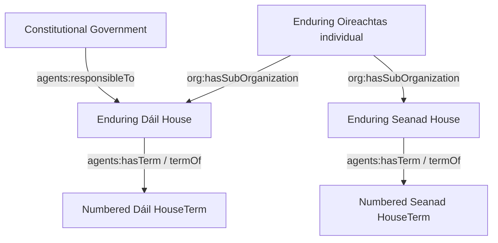
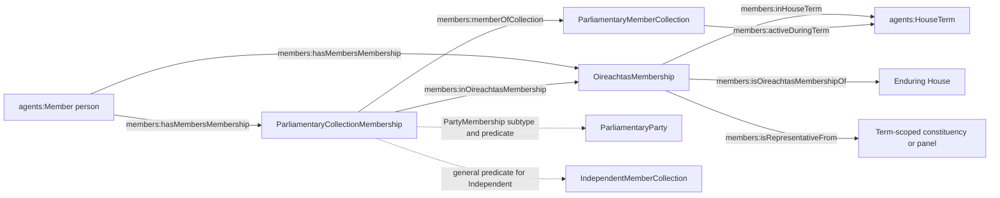

# A guide to the Oireachtas ontology

This guide explains the model that is implemented in the repository, not a
proposal for a future model. Its terminology follows the executable OWL modules
and active mappings. For formal axioms and complete term inventories see
[`ontology/README.md`](../ontology/README.md); for API-to-RDF decisions see
[`mapping_notes.md`](mapping_notes.md), the endpoint CSVs in `mappings/`, and
[`etl-plan.md`](etl-plan.md). Focused design records are linked below.

## Reading the graph

RDF statements have a subject, predicate and object. A person does not point
directly to a party as though party affiliation were a timeless attribute.
Instead, the graph uses a dated membership record as the relationship. Resource
IRIs identify particular things; labels are display text and are not identity
keys. Named graphs group statements by owner, but a relationship may point from
one owner's graph to a resource described in another.

Prefixes used here: `agents:` = `https://data.oireachtas.ie/ontology#`,
`members:` = `https://data.oireachtas.ie/ontology/members#`,
`debates:` = `https://data.oireachtas.ie/ontology/debates#`, `foaf:` =
`http://xmlns.com/foaf/0.1/`, `org:` = `http://www.w3.org/ns/org#`,
`skos:` = `http://www.w3.org/2004/02/skos/core#`, and `eli-dl:` =
`http://data.europa.eu/eli/eli-draft-legislation-ontology#`.

## Institutions, Houses, terms and Government

The ontology distinguishes a class from an individual institution. The enduring
Oireachtas is the individual `<https://data.oireachtas.ie/oireachtas>` (an
`agents:ParliamentaryBody`), not an `agents:Oireachtas` class. Its enduring Dáil
and Seanad individuals are `agents:House`s, related using ORG
`org:hasSubOrganization` / `org:subOrganizationOf`. This is a part-whole
relationship, not subclassing.

A numbered Dáil or Seanad is a time-bounded `agents:HouseTerm` (also an ELI-DL
ParliamentaryTerm), not an enduring House. `agents:termOf` links the term to its
House; `agents:hasTerm` is the inverse. Term number, seats and a `dct:temporal`
period with `dcat:startDate` and optional `dcat:endDate` describe the term.
Memberships refer to both the continuing House and the numbered term. A null
end date means the source has not supplied an end date; it does not establish
that every person or other term-specific relationship is currently active.

The constitutional Government is a distinct enduring `agents:Government`
individual at `<https://data.oireachtas.ie/government>`, accountable to the
enduring Dáil through `agents:responsibleTo` (a subproperty of
`org:reportsTo`). It is not a ParliamentaryBody. The generic Government bill
submitter `<https://data.oireachtas.ie/ie/oireachtas/def/bill-source/government>`
is only a controlled source concept and is not the Government institution.
Government membership is represented through person/role records rather than
by confusing parliamentary representation with executive office.

*Simplification:* the diagram leaves out the types, inverse links and time
period resources. The constitutional President is not modelled/populated in
this ETL scope; do not infer a President resource from the constitutional
composition of the Oireachtas. See [`house_model.md`](house_model.md).

**Population:** HouseTerms and House labels are Houses-owned. The ontology
defines the enduring Government individual, but a global lookup for its
assertions returned no rows in the development dataset inspected on
2026-10-20. The snapshot does include office holdings and CabinetMembership
records referring to Government. The Government individual's lack of a
description in that snapshot is a graph-availability limitation, not a reason
to conflate it with the separate generic bill-source concept.

## People, parliamentary membership and representation

`agents:Member` is the person. The same person's identity persists over a
career; memberships are separate `org:Membership`-pattern records, typically
with a deterministic IRI below the person's URI. An `members:OireachtasMembership`
records service in a particular HouseTerm and links to:

* the enduring House (`members:isOireachtasMembershipOf`);
* the numbered term (`members:inHouseTerm`);
* its own date range (`members:hasMembershipDateRange`); and
* a representation resource (`members:isRepresentativeFrom`) when the source
  supplies one.

The membership record's date range is not interchangeable with the HouseTerm's
overall dates. A Member may have successive OireachtasMembership records and
can be a Deputy and Senator at different points in a career.

Constituencies and Seanad panels are distinct `members:Constituencies`
subclasses (`DailConstituency` and `SeanadPanel`). Their IRIs are term-scoped;
`members:constituencyInHouseTerm` links the resource to that term. The
representation assertion is from the OireachtasMembership record to the
constituency/panel; query its owner graph for the display label.

### Parties are collections, not the membership record or enduring party

Three terms must not be collapsed:

* `members:ParliamentaryMemberCollection` is the general group-of-Members
  category.
* `members:ParliamentaryParty` is a **term-scoped collection** from a
  non-Independent Parties API record. Its source IRI and term context are
  important identity. It represents Members associated with the same registered
  party for parliamentary purposes; it is not the enduring registered
  political-party organisation.
* `members:IndependentMemberCollection` is a term-scoped API collection for
  non-party/Independent status. It does not mean Independents form one party or
  recognised group.

The dated `members:ParliamentaryCollectionMembership` is the relationship
between a Member and a collection. The record uses `members:memberOfCollection`
and `members:inOireachtasMembership`, with its own
`members:hasMembershipDateRange`. If the collection is a ParliamentaryParty,
the record is also a `members:PartyMembership` and uses
`members:isPartyMembershipOf`. For Independent collections, only the general
collection-membership class is used. A party collection itself may refer to a
HouseTerm via `members:activeDuringTerm`; that is not a substitute for the
dated membership record.

`members:ParliamentaryGroup` and `members:TechnicalGroup` are recognised-group
concepts grounded in Standing Orders, not synonyms for party. A party might
also be a group if independently evidenced, but one class does not imply the
other. The current Parties/Members API ETL does not populate group instances.
Reviewed external matching of a term-scoped party collection uses
`members:recognisedAsParty`; it is not `owl:sameAs` and not a group-recognition
assertion. See [`parliamentary-member-collection-model.md`](parliamentary-member-collection-model.md).

*Simplification:* the diagram omits membership-specific date-range nodes and
their `members:StartDate` / `members:EndDate` values. The dotted PartyMembership
link represents the more specific class/property pattern, not an additional
assertion required for Independent records.

### Worked identity: Bertie Ahern, Fianna Fáil, Dublin Central

The known Member identity is
`<https://data.oireachtas.ie/ie/oireachtas/member/id/Bertie-Ahern.D.1977-07-05>`.
His source-backed Member record links to separate Dáil-term OireachtasMembership
records. The 22nd Dáil membership refers to the term-scoped constituency
`<https://data.oireachtas.ie/ie/oireachtas/house/dail/22/constituency/Dublin-Central>`
and a separate PartyMembership record whose target is the 22nd-Dáil collection
`<https://data.oireachtas.ie/ie/oireachtas/party/dail/22/Fianna_Fáil>`.
His 21st-Dáil representation was Dublin Finglas, not Dublin Central. The
example illustrates why joining by the human label alone loses historical
context: Dublin Central, Fianna Fáil and the membership are all time/term
scoped. Query the party and constituency owner graphs for labels; they are not
re-described in every Member graph. These details were observed in the local
development Fuseki dataset on 2026-10-20, not certified production data.

The Member IRI comes from the API `member.uri`; `memberCode` is retained as an
identifier and used in the per-Member graph convention. Reconciliation does
not replace that local identity: reviewed external identity links live in
separate external-link graphs, and `owl:sameAs` is reserved for an accepted
same-person identity (Wikipedia uses `foaf:isPrimaryTopicOf`). A name match
alone is not identity evidence. See
[`member-reconciliation.md`](member-reconciliation.md).

## Committees and committee membership

`members:Committee` is an `org:Organization`; its API IRI is shared/term-aware
and its description belongs to the Committee owner graph. A Member's
`members:CommitteeMembership` is a separate dated relationship, linked from the
Member with `members:hasMembersMembership` and to the committee with
`members:isCommitteeMembershipOf`. It can carry a committee role using
`members:hasCommitteeRole` (for example Chair or DeputyChair). Committee
membership is not House membership; committees are not typed as enduring
Houses merely because they sit in a chamber.

The model has concepts for committee type and purpose. Committee operational
dates, lifecycle status, expiry and historical name periods have deferred
mapping gaps; absence of those details is not evidence that the committee did
not exist. Current development owner data has Committee descriptions and Member
committee memberships; the live example snapshot had 267 Committee identities
and 3,054 CommitteeMemberships.

## Ministerial offices, administrative units and Government membership

These resources express related but different things:

* `members:NamedOffice` is an enduring identity for a particular institutional
  office, independent of holder and label.
* `members:AdministrativeUnit` is a distinct organization, such as a
  department, only when positively identified.
* `members:OfficeHolding` is a time-bounded `org:Membership` linking a Member
  and one NamedOffice. `members:heldOffice` identifies the office;
  `members:officeHolder` / `members:hasOfficeHolding` link holder and record;
  its date range belongs to the holding.
* `members:OfficeType` is a SKOS category on a NamedOffice via
  `members:hasRoleType`; it is not itself an OWL role or a NamedOffice.
* `members:CabinetMembership` links a Member's Cabinet role to constitutional
  Government and may be supported by one or more office-holding episodes.

Person, role, office identity, administrative unit, and holding are distinct
IRIs. The vocabulary also separates constitutional Government,
`members:GovernmentExecutive`, and `members:GovernmentBenches`; the latter is a
parliamentary whip bloc, not a government administration. Do not infer one
layer from another. Office identity population is a reviewed local registry
bootstrap; source office-name strings alone do not mint identities. Current
development data has 3 NamedOffices, 22 OfficeHoldings, 22 CabinetMemberships
and 1 AdministrativeUnit; this small count explicitly does not establish full
office coverage. See [`ministerial-office-registry.md`](ministerial-office-registry.md)
and [`office-external-reconciliation.md`](office-external-reconciliation.md).

## Bills and parliamentary activity

A Bill is represented using ELI/ELI-DL resources rather than a parallel local
BillResource class. The transformer creates the Bill Work and a deterministic
LegislativeProcess (`#process`); the process holds process number/type/status,
submitting source, latest activity and participation. Concrete lifecycle
activity and stage occurrences point to the process using
`eli-dl:forms_part_of`. Controlled stages, event/activity types and statuses
are vocabulary individuals, not occurrences. The current transformer does not
emit an RDF predicate from the Bill Work to its LegislativeProcess; the shared
Bill graph is an ownership/container convention, not that missing relationship.
Therefore a SPARQL consumer cannot traverse from the Bill Work IRI to its
process using an asserted edge. This is a code-to-mapping/design-contract gap
for owner review; this guide does not choose a replacement predicate. A Bill's
originating House, HouseTerms, and sponsoring Members are references to
separately owned resources; Bill graphs do not recreate those descriptions.

Bill versions and related documents distinguish Work, Expression and Format;
amendment lists, sponsorship participation and lifecycle events have their own
resource identities as supported by source mappings. Source data gaps,
quarantines and precise identity rules are documented in the authoritative
[`etl-plan.md`](etl-plan.md) Phase 4 contract and
[`mappings/bill_mapping.csv`](../mappings/bill_mapping.csv). Development Fuseki currently has
6,044 Bill graphs (2026-10-20 snapshot); this is local, non-production evidence.

## Debates, questions and votes

The Debates vocabulary represents a `debates:DebateRecord` Work, its
`debates:DebateExpression`, a `debates:DebateSitting` where source evidence
supports an actual sitting, nested `debates:DebateSection`s, `debates:Speech`,
`debates:Summary`, `debates:ParliamentaryQuestion` and `debates:Division` (an
ELI-DL Vote). Sections contain immediate questions, speeches, summaries or
subsections; debate expressions provide top-level section/order scope. A
written-answer record is still a DebateRecord, but does not imply a sitting.
Question-to-answer one-to-one links are not asserted. Votes preserve counts and
individual vote records where source-supported; unknown `#declared` is not
converted into carried/lost. Committee roll-call attendance remains source-only
and is not treated as a vote.

Debate graphs reference existing Member, House, HouseTerm, Committee, office and
Bill resources where an exact supported resolver match exists; unresolved
references do not create placeholder identities. Transcript text is not RDF.
The ontology and deterministic transformer are implemented, but the current
development snapshot had only three Debates graphs. Phase 7 says the approved
2011+ production selection has not been ingested; production ingestion is
blocked pending readiness/operational decisions. Thus schema support and
fixture/test evidence do not imply production availability. See
[`phase-7-debates.md`](phase-7-debates.md),
[`debates-identity-contract.md`](debates-identity-contract.md) and
[`debates-semantic-review.md`](debates-semantic-review.md).

## Time, identity and graph traversal: practical rules

1. **Do not treat a label as identity.** `Fianna Fáil` resolves to distinct
   term-scoped collection IRIs; Dublin Central likewise has a different IRI
   under each HouseTerm. Require House/term, date, code or a resource IRI when
   the question implies one specific occurrence.
2. **Follow the relationship record.** Member-to-party, Member-to-constituency,
   office-holder-to-office and Member-to-committee are not timeless direct
   attributes. Read the corresponding membership record and period.
3. **Use interval overlap, not same-term alone, for a date question.** For
   closed intervals, A overlaps B when `A.start <= B.end` and `B.start <=
   A.end`. Treat a missing end according to the user's intended “open/current”
   question; it can mean unknown/open at source, not “forever”. Validate date
   datatypes and do not silently compare incompatible strings.
4. **Join owner graphs explicitly.** A Member graph may point to a party,
   constituency, HouseTerm, office or Committee that is described in another
   named graph. Join by the same IRI, not equal labels.
5. **Distinct IRI means distinct modeled identity unless the contract links
   them.** Similar names do not make entities identical. In particular,
   different term-scoped Fianna Fáil collection IRIs are separate
   ParliamentaryParty entities; an accepted enduring external party target is
   linked by `members:recognisedAsParty`, not identity.

For runnable patterns and explanation of named graph scope, continue to the
[`SPARQL cookbook`](sparql-cookbook.md) and
[`Direct graph exploration guide`](direct-graph-exploration.md).
